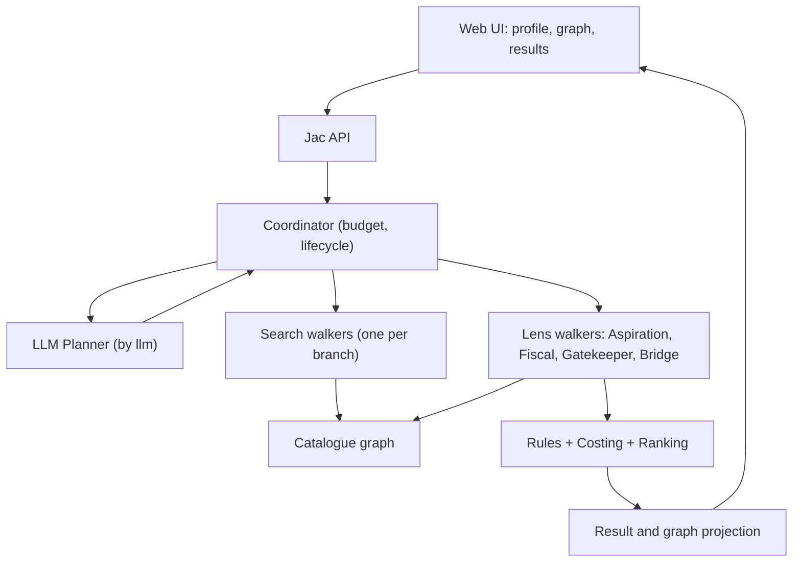

# UniPath LK: Hackathon Architecture (Practical + Winning Edition)

**Date:** 17 Oct 2026 | **Build window:** about 10:30 to 17:30 | **Language:** Jac (target 80%+ handwritten)
**Supersedes:** the long architecture MD and the PDF blueprint for today's build. Keep both as the long-term roadmap.

---

## 0. The one-paragraph pitch

UniPath LK finds **multi-step education routes** for Sri Lankan post-A/L students. Four lens walkers (Aspiration, Fiscal, Gatekeeper, Bridge) search a typed graph of real programmes and evaluate every route against the student's profile. An LLM planner decides what to do next, such as asking one clarifying question or searching an alternative. Deterministic code validates everything, so nothing is invented. The graph turns red, amber or green live, and unknowns are shown honestly.

**Differentiator:** most teams will demo a chatbot with fake confidence. We demo an agent that searches, disagrees with itself visibly, asks a question, and never fabricates.

---

## 1. Judging criteria to design decisions

| # | Criterion | What judges look for | What we build to hit it | Demo proof |
|---|---|---|---|---|
| 1 | **Depth of agentic behaviour** | Does the agent decide, or just show data? | LLM planner picks from 4 typed actions (`ask_student`, `search_alternatives`, `evaluate_candidates`, `finish`) based on observations. The Bridge walker uses the LLM to **rank and explain real catalogue routes**. Backtracking on dead ends. | Two different profiles trigger two different action sequences. An answer visibly changes the route. |
| 2 | **Excellent use of Jac/Jaseci** | Nodes, walkers, edges, `by llm` used meaningfully, 80% Jac | Catalogue = nodes + typed edges (`Offers`, `Awards`, `Requires`, `ProgressesTo`, `SupportsGoal`). One walker instance per branch. Four lens walkers. `by llm()` for the planner. All logic in Jac; frontend in native Jac client where supported. | 60-second source walkthrough, then the live graph projection from real nodes. |
| 3 | **Technical execution** | Live on Jac Hammer, no bugs | Modular monolith, one `jac.toml`, deterministic fallback if the LLM fails, 6 core tests, smoke flow run before demo. | Deployed URL works end to end, including with the API key removed (fallback). |
| 4 | **Creativity and innovation** | Something not seen before | **Council of lenses on a live graph**, **whole-route validation with three-valued logic**, **cash-flow cost model** (the cheap route is not always the cheap route), **stress test deltas**. | The "direct degree fails on cash, 3-step route works" moment. |
| 5 | **Impact and novelty** | Truly useful to people | Free, anonymous, no accounts. Shows costs, shortfalls, conditions, evidence links and next actions. Honest about uncertainty. Scales region by region by adding data only. | One real student problem solved start to finish. |
| 6 | **Presentation and 2-3 min demo** | Clear story | Fixed 5-beat script (section 12). Demo banner and evidence labels make honesty visible. | Rehearsed twice; screen recording captured as a backup. |

---

## 2. Scope: what is IN today and what is OUT

### IN (must work)

1. Profile form (goal, qualifications, savings, monthly budget, relocation, study mode).
2. Graph search: direct and multi-step routes, with cycle-safe, branch-isolated walkers.
3. Rule evaluator with three-valued logic (pass / fail / unknown).
4. Cash-flow costing (upfront vs monthly, minimum balance, shortfall).
5. Four lens walkers producing per-request findings shown on each node.
6. LLM planner with 4 actions, bounded budget and **rules fallback**.
7. One clarification question, then a recompute on the revised profile.
8. Graph UI: red / amber / green nodes and edges, click for rule + evidence.
9. Small **real IT-domain dataset** with per-claim evidence status, plus the **fictional fixture** for tests.
10. Stress test button (travel +40%, 6-month delay) showing deltas, with no probabilities.
11. Deployment on Jac Hammer and a smoke test.

### OUT today (documented roadmap only)

Accounts and saved plans, Minimum Change Finder, Gap Finder, multilingual UI, live scraping, admin tooling, loan modelling, parallel study/work, Z-score "chance of selection" numbers, nationwide data.

### Hard rules (never break these)

- No invented institutions, exemptions, fees or bridges shown as real.
- No "survival rate" or "89% confidence" numbers.
- The LLM never sets eligibility, writes to the catalogue, or fetches URLs.
- Unknown (`null` in JSON, `None` in Jac) means unknown, never free or zero.
- Demo and real data are labelled visibly.

---

## 3. System overview



**Pattern:** the LLM suggests, deterministic code decides. State is **request-scoped** (stateless guest). The browser holds the profile and sends it in full each time with `conversation_id` and `profile_revision`.

---

## 4. The Council of Lens Walkers

This keeps the PDF's best idea but fixes its flaws (shared mutable blackboards, a cosmetic LLM call, fake bridges).

| Lens | Type | Question it answers | Output (per node, per request) |
|---|---|---|---|
| **Aspiration** | Deterministic | Does this route actually support the chosen goal, and how well (award level, study mode, duration)? | `fit` tag and reason |
| **Fiscal** | Deterministic | Can the student fund this given savings and monthly budget? Minimum balance, shortfall, recurring gap. | `cash_ok / shortfall / unknown_cost` |
| **Gatekeeper** | Deterministic | Do entry requirements pass, fail or stay unknown? Is the evidence verified, unreviewed or fixture? | `pass / fail / unknown` + evidence IDs |
| **Bridge** | LLM-assisted, validated | When the direct route is blocked, which **existing catalogue routes** best repair it, and why? | Ranked route proposals plus plain-language explanation |

**Blackboard, done safely:** each lens emits `Finding` objects into a request-scoped list. The UI renders them as per-node notes ("Fiscal: needs 22,000 extra upfront. Gatekeeper: Diploma required first"). Nothing is written to shared nodes, so two users never mix.

**Bridge rules:**
- It may only choose among candidates produced by graph search, or among catalogue transitions marked `unreviewed`, which are drawn **amber** as "needs confirmation".
- Any proposal outside the catalogue is rejected by the validator and is never drawn as a route. (Optionally show it as a dashed grey "idea to ask an advisor", clearly not a plan.)
- The LLM output must change something real: ordering of alternatives and the explanation text. Verify this in a test with a stubbed LLM.

---

## 5. Domain model (trimmed for today)

Jac **nodes**: `Institution`, `Qualification`, `CourseOffering`, `CareerGoal`, `EvidenceClaim`.
Jac **objects**: `StudentProfile`, `RequirementExpr`, `CostItem`, `SearchState`, `CandidatePlan`, `Finding`, `Question`, `DecisionEvent`.
Jac **edges**: `Offers`, `Awards`, `Requires`, `ProgressesTo`, `SupportsGoal`, `SupportedBy`.

Key conventions:
- IDs are stable application IDs, not native graph IDs.
- Amounts are integer LKR. Unknown = `None` in Jac (`null` in JSON), e.g. `int | None = None`.
- A course is an **offering**: campus, mode and intake matter. UCSC BIT and Moratuwa BIT are different records.
- SLQF and NVQ claims are separate fields, each with its own evidence. Never infer one from the other.
- `ProgressesTo` carries `transition_type`, `requirements`, `evidence_claim_ids`, `status`, and an optional validated cost/duration change. An exemption with no mapped effect changes nothing.

### Evidence status (per claim)

`verified` | `unreviewed` | `fixture` | `stale` | `rejected`

UI colours: verified = solid, unreviewed = amber, fixture = grey with a demo banner.

---

## 6. Data strategy: small now, scalable later

### 6.1 Two catalogues, one schema

| File | Purpose | Shown as |
|---|---|---|
| `data/demo/catalogue.json` | Fictional fixture with hand-checkable numbers (tests and fallback demo) | **DEMO** banner |
| `data/real/catalogue.json` | Small real IT-domain set | Per-claim status |

Both use the **same loader and schema**. Scaling to other regions or fields later means adding rows, with no code change. That is the "all data, all regions in future" story.

### 6.2 Real data we attempt today (IT domain)

Starting points from the PDF, **all unreviewed until a source is attached**:

| Institution | Programme | Notes |
|---|---|---|
| SLIATE | HNDIT | Fees, intake and entry rules must come from the official page |
| UCSC | BIT (External) | Confirm the current entry rule and fee structure |
| UoM | BIT (Moratuwa) | Separate offering from UCSC BIT |
| UNIVOTEC | B.Tech | Check the NVQ-based entry claim |
| NAITA/VTA | NVQ IT courses | Confirm level and duration |

**Rules for adding a real record (about 10 minutes each):**
1. Copy the exact official URL and the relevant excerpt into an `EvidenceSource`.
2. Fill only the fields the source states. Everything else stays `null`.
3. Express entry requirements as a `RequirementExpr` (`all` / `any` plus predicates).
4. Mark the claim `verified` only if the source covers **that specific field, programme and intake**. Otherwise `unreviewed`.
5. A `ProgressesTo` edge exists **only** if an official source documents the transition. If not, do not add the edge. (This replaces the PDF's invented "NVQ 6 exemption" bridge.)

**Budget:** time-box real data to about 90 minutes total. Target **2 meaningful real routes**, not 15 to 20. If a route has no documented transition, demo it as direct entry plus an honest "possible transition: ask the institution" note.

### 6.3 Fallback if real data is thin

Lead the demo with the **fixture** (clearly labelled), then show the real data as "live catalogue, partially verified". Never blend them in one result set.

### 6.4 Region-scaling hook (future, costs nothing now)

Each offering has `district`/`campus` and `delivery_mode`. The relocation question uses these. Adding Jaffna, Kandy or Galle data later is a data change only.

---

## 7. Search algorithm (Jac walkers)

```text
relevant = goal ancestors via SupportsGoal / Awards / ProgressesTo (bounded)
frontier = entry states from offerings that pass or are unknown for this profile
while frontier and within limits:
    state = pop in stable order
    skip if progression signature already seen   # per branch, not global
    findings = validate_next_step(state)
    if known hard failure: keep as blocked, backtrack to the last fork
    next = copy_and_apply(state)
    if goal reached: re-validate whole plan, keep candidate
    for each ProgressesTo edge: spawn a NEW walker with a COPY of the state
```

- **One walker per branch** with its own immutable or copied `SearchState`. Never share one mutable accumulator across `visit` children.
- **Copy collections when spawning.** In Jac, `list` and `dict` values are passed by reference between walkers. Build a fresh copy for each child, e.g. `list(state.visited_path)` and `dict(state.costs)`, so two branches never mutate each other's state.
- **Visited signature** = current offering + accumulated qualifications + transition history. Not a global "visited course" set.
- **Backtracking** (visible in the UI): a blocked branch is logged as a `DecisionEvent` ("blocked at X, retracing to fork Y, trying Z").
- **Limits (configurable):** 4 steps, 100 expanded states, 20 candidates, 3 shown. If hit, return `search_truncated: true`.
- **Deterministic ordering** so tests are repeatable.

> The pseudocode is not Jac syntax. Verify walker spawn and visit semantics in the installed Jac version before relying on them (see section 13).

---

## 8. Rules, status and cost

### Three-valued logic

| Group | Pass | Fail | Unknown |
|---|---|---|---|
| `all` | all children pass | any child fails | no fail, at least one unknown |
| `any` | any child passes | all children fail | no pass, at least one unknown |

No `eval`. Rules are an allowlisted AST evaluated by named functions.

### Route status (first match wins)

1. Known hard failure → `not_feasible_under_current_inputs` (red)
2. Missing data, evidence or essential cost → `needs_confirmation` (amber)
3. Future completion or selection required → `conditional` (amber-green)
4. Otherwise → `feasible_under_stated_assumptions` (green)

All findings are kept even when one decides the status.

### Cash-flow model (monthly)

- Month 0 = start of the first course.
- Upfront costs are due at the start of the month; monthly contribution arrives at month-end.
- `balance = savings`; each month subtract upfront costs, record the minimum, add the contribution, subtract recurring costs, record the minimum.
- `extra_initial_cash_needed = max(0, -minimum_balance)`.
- Unknown essential cost → incomplete ledger → `needs_confirmation`, never "affordable".

### Fixture expectations (test oracle, fictional data)

| Route | Total | Minimum balance | Result |
|---|---:|---:|---|
| Direct degree | 84,000 | -22,000 | Needs 22,000 extra upfront |
| Foundation → Diploma → Top-up | 54,000 | 0 | Conditional on completing each step |
| Same direct route with savings 24,000 | 84,000 | 0 | Shortfall disappears |

### Stress test (replaces the "Ghost Walker" survival score)

Re-run the same engine with labelled changes: travel costs +40%, a 6-month delay, optional user-entered income. Show **absolute deltas** in cost, shortfall and duration. No probability or resilience percentage.

---

## 9. LLM planner and fallback

**Actions (typed, allowlisted):**

| Action | Guard |
|---|---|
| `ask_student(field)` | Field is missing and relevant to a blocker |
| `search_alternatives(filters)` | Existing goal only; hard constraints are not relaxed; no repeated identical search |
| `evaluate_candidates(ids)` | Only IDs issued in this run |
| `finish` | Coordinator builds authoritative results |

**Model input:** the minimum profile fields, catalogue titles and IDs, compact findings, the action list and remaining budget. No name, NIC or contact details.
**Budget:** at most 3 provider attempts, 8 s per attempt, 30 s per run.
**Fallback:** on missing key, timeout, malformed output or unknown IDs, switch to the deterministic question list. Report `planner_mode: live_ai | rules_fallback | mixed` and a `fallback_reason`. Never present fallback as AI reasoning.
**Question choice:** deterministic utility (how many candidates the answer could change, blocker severity, effort). The LLM picks from that shortlist and cannot invent questions.

**Where the LLM visibly matters (for criterion 1):**
1. Choosing the next action.
2. Bridge lens ranking of repair routes.
3. Phrasing the "why this route" explanation from supplied result fields only.

---

## 10. API (logical operations)

| Operation | Purpose |
|---|---|
| `get_app_info` | Catalogue mode, version, feature flags |
| `get_catalogue_projection` | Whitelisted nodes and edges for the graph |
| `plan_pathways` | Full profile, revision, conversation ID → candidates, blocked candidates, pending question, events |
| `get_evidence` | Claim and source records |
| `run_stress_test` | Same profile plus a named scenario → deltas |
| `health` | Readiness (fails if the catalogue import failed) |

- The server recomputes everything and ignores client-submitted results.
- The client discards any response whose `profile_revision` is older than the latest.
- A zero-feasible-route result is a valid `ready` business result with reasons, not an error.
- Do not invent route names; document the actual Jac-generated routes after the scaffold exists.

---

## 11. Frontend

One responsive page.

- **Left:** profile form and the pending question card.
- **Centre:** the graph from the backend projection. Node colours: red = blocked, amber = unknown or unreviewed, green = feasible or conditional, grey = fixture. Use icons or text as well as colour. Click a node or edge to see its rule, findings and evidence.
- **Right:** top 3 route cards (steps, cost breakdown with known / estimated / unknown, duration, conditions, evidence links, next actions) and a "Why an option was excluded" list.
- **Drawer:** activity log of decision events (actions, backtracking, fallback).
- **Banner:** DEMO or REAL mode, plus planner mode (AI vs rules fallback).
- The UI never computes eligibility or totals.

---

## 12. Demo script (2-3 minutes)

1. **Setup (15 s):** "Students don't need a list of courses. They need a route they can afford." Show the DEMO banner honestly.
2. **Conflict (30 s):** enter the low-savings profile. The direct degree turns **red** ("Fiscal: needs 22,000 extra upfront"). Show the lens notes on the node.
3. **Multi-step win (30 s):** the Foundation → Diploma → Top-up route turns green/conditional. Total 54,000, no extra cash needed. "A direct-only filter would have shown nothing."
4. **Agentic moment (30 s):** the planner asks "Can you relocate?" (or a real blocker question). Answer it and watch the graph recompute. Point to the activity log, including a backtracking event and the planner mode.
5. **Stress test (20 s):** travel +40% shows the cost and shortfall deltas. "No made-up percentages."
6. **Real data + close (30 s):** switch to the real IT catalogue, with verified and amber evidence labels. "Add rows, and it scales to every region. Everything shown is validated, and unknowns are flagged."

**Rehearse twice. Record a backup video before 16:30.**

---

## 13. Jac constraints and unknowns to resolve first (first 45 minutes)

### Jac rules for today's build (from the team's notes)

1. **Keep backend code in 1-2 `.jac` files** (`main.jac`, optionally `tests.jac`). Cross-file `include` / `import` can cause circular-import problems, and that risk is not worth it in a 6-hour build. The module split in section 18 is a logical grouping (sections within `main.jac`), not separate files.
2. **Use `None`, never `null`, in `.jac` code** (e.g. `int | None = None`), even when the source JSON contains `null`.
3. **Copy `list` / `dict` state when spawning branch walkers** (see section 7); they are passed by reference.

> **Version check:** these notes cite Jac v0.16.7, but `CLAUDE.md`, `AGENTS.md` and `README.md` say the project environment is Jac 0.34.23. Run `jac --version` and treat the installed compiler as authoritative; re-verify the three rules above against it.

### Unknowns

Do not claim any of these until tested in the actual scaffold:

- Walker spawn and visit semantics with a **copied** `SearchState` per branch.
- `by llm()` setup: model identifier, structured (typed) output, timeout and retry control.
- How API endpoints and walkers are exposed in the generated template.
- Graph initialization hook (load the catalogue once at startup, not per request).
- Native Jac client capabilities for the graph view.
- How to count "80% Jac" and what organisers accept; record the method.

**Spike test (30 min):** one tiny graph, one branching walker, one typed `by llm` call, one endpoint. If this passes, build on it. If it fails, simplify (for example, run the branches sequentially from a coordinator function).

---

## 14. Time-boxed plan for today

| Time | Deliverable | Gate |
|---|---|---|
| 10:30-11:15 | Scaffold, versions recorded, spike test (branch walker, `by llm`, endpoint) | Spike passes, preview runs |
| 11:15-12:45 | Models, requirement evaluator, fixture loader, search walkers | T01, T02, T03, T08 pass |
| 12:45-13:30 | Cost engine and status grouping (lunch in parallel) | T05 numbers match: 84,000 / 54,000 / -22,000 |
| 13:30-14:30 | Lens findings, API, clarification and replan, fallback | Profile → question → revised result works with no API key |
| 14:30-15:15 | Live planner with `by llm`, budgets, fallback labels | One real action observed; T11 passes |
| 15:15-16:15 | UI: form, graph projection, cards, activity log, stress test | Backend results match the UI; stale-response check |
| (parallel) | Real IT data entry, max 90 minutes in total | 2 routes with evidence; otherwise stay fixture-led |
| 16:15-16:45 | Deploy, smoke test (readiness, plan, question, fallback, banner) | Live URL works |
| 16:45-17:30 | Demo rehearsal, backup recording, README and handoff | Two clean runs |

**Cut order if behind schedule:** stress test → real data beyond 1 route → live planner (keep fallback, state it honestly) → graph polish. Never cut: search, rules, costing, deployment, demo rehearsal.

---

## 15. Tests (minimum set)

| ID | Assertion |
|---|---|
| T01 | Direct and multi-step candidates are both found |
| T02 | AND prerequisite missing → requirement fails despite an incoming edge |
| T03 | Unknown field → `unknown` and a relevant question |
| T05 | Fixture totals and shortfall match section 8 |
| T08 | Cycle terminates; branches do not contaminate each other |
| T11 | No key / timeout → labelled fallback |
| T13 | Tampered client result is ignored; server recomputes |

Plus a smoke test of the deployed URL. Report honestly which tests ran and whether the live-provider test ran.

---

## 16. Honest-metrics slide (for judges)

- Constraint violations in top recommendations: **0 of N** (state N).
- Evidence coverage: X verified of Y required claims in the real set (fixture excluded).
- Direct-only vs multi-step: how many additional valid or conditional routes the graph found.
- Latency and provider attempts: measured, not estimated.
- Search limits and truncation: stated.

No badges for numbers we did not measure.

---

## 17. Roadmap (say it, do not build it)

- **Stage C:** Minimum Change Finder, Gap Finder, scenario comparison, verified early exits.
- **Stage D:** reviewed regional catalogue expansion, private saved plans, Sinhala and Tamil, rate limiting suited to multi-replica hosting, source-refresh operations.

---

## 18. Repo and workflow

```text
jac.toml
main.jac  all backend code, in labelled sections: models, rules, catalogue, search, lenses, costing, ranking, planner, api
tests.jac (optional) core tests
frontend/ profile, graph, results, evidence, activity
data/     demo/catalogue.json  real/catalogue.json
tests/
docs/     architecture.md  data-review.md  handoff.md
README.md  AGENTS.md  CLAUDE.md  .env.example
```

Keep backend in `main.jac` (plus optional `tests.jac`) to avoid circular imports. Adapt filenames to the generated Jac Hammer template. Secrets stay server-side and out of Git. Workflow: Jac Hammer → GitHub → local → back to the same Hammer project → deploy. Verify the commit SHA before deploying. For a one-day build, stay in one environment until the slice works.

---

## 19. Definition of done (today)

- [ ] Deployed URL works end to end (profile → graph → question → revised result).
- [ ] Works with the API key removed (labelled fallback).
- [ ] Direct vs multi-step comparison visible in the graph.
- [ ] Four lens notes visible per node.
- [ ] Evidence status labelled on every shown route.
- [ ] No fabricated institutions, bridges, fees or probabilities anywhere.
- [ ] Core tests green; results reported honestly.
- [ ] 2-3 minute demo rehearsed, with a backup recording.
