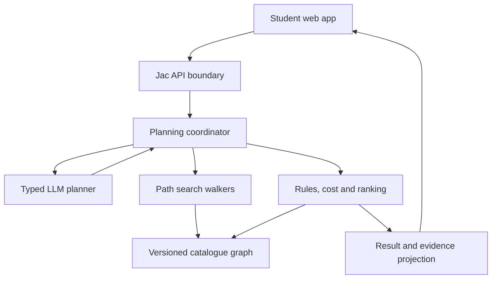
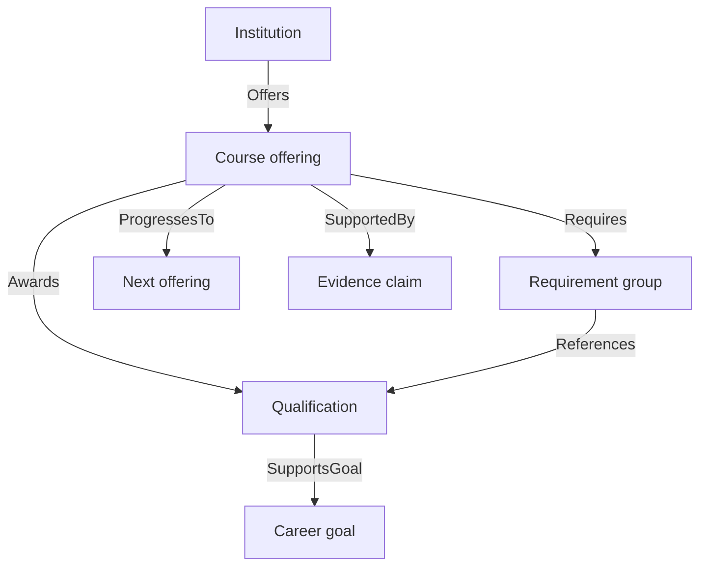
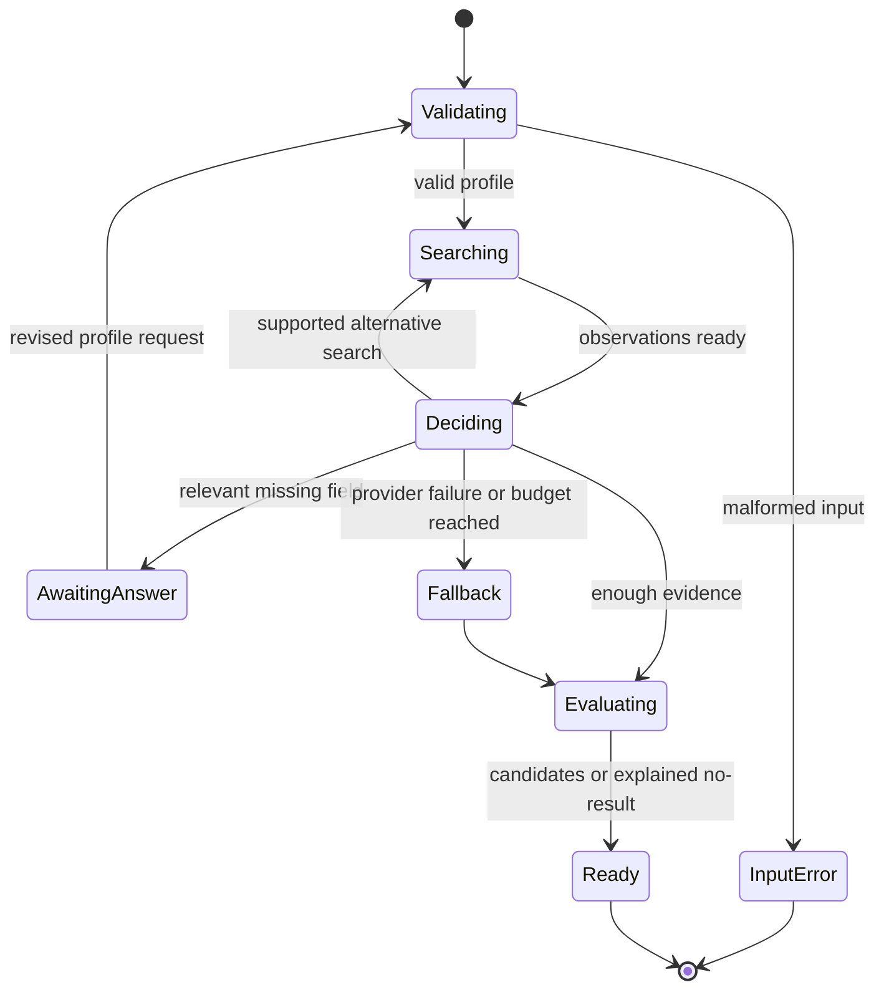
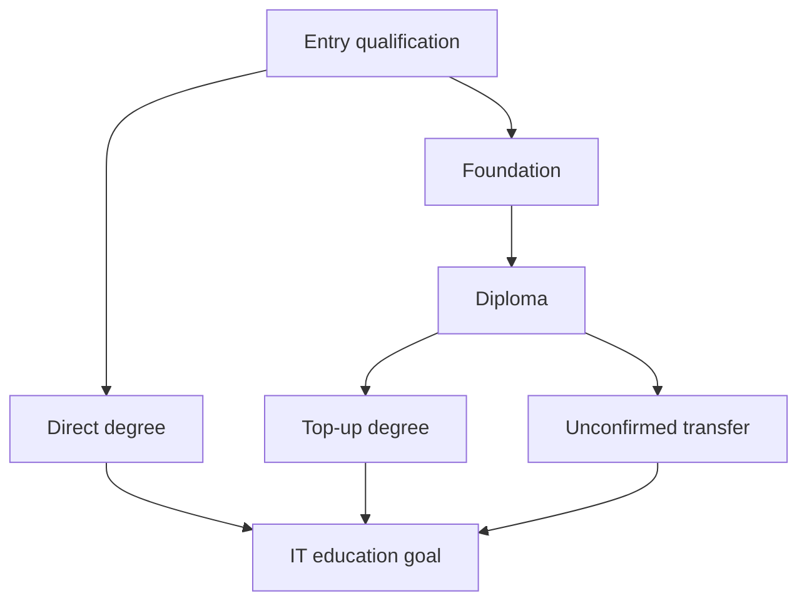

# UniPath LK — Complete Application Architecture

**Version:** 1.0 • **Date:** 17 October 2026  
**Audience:** implementation team, Claude Code, Codex, and Jac Hammer  
**Status:** implementation specification; no application repository has been inspected, built, or deployed as part of this document.

## 1. Product decision and scope

UniPath LK is a free, openly accessible education-pathway planning application for Sri Lankan post-A/L students. It explores routes from a student's current qualifications to a selected education/career goal, evaluates the entire route against evidence and constraints, asks relevant questions, and explains feasible alternatives and next actions.

The core question is: **“Given what I have, what I can afford, and what I can change, which supported sequence of education steps can move me toward my goal?”**

A career goal describes an aspiration, not a guaranteed job. Meeting minimum entry requirements does not guarantee selection or admission. A proposed later step remains conditional on completing earlier steps and satisfying the applicable future intake rules.

### Delivery boundaries

| Stage | Must deliver | Not required at this stage |
|---|---|---|
| A — Jac Hammer initialization | Runnable Jac app, real graph search, deterministic validation/costing, a bounded planner interface, guest clarification/replan flow, labeled fixture catalogue, tests, repository handoff | Nationwide data, exhaustive financial planning, persistent accounts, complex multi-agent debate |
| B — Local hackathon completion | Reviewed IT-domain catalogue, live planner where configured, evidence-aware results, tested deployment, compact activity log, demo-ready scenario | Advanced administration, live scraping, automated applications |
| C — First useful extensions | Minimum Change Finder, Gap Finder, cost/delay scenario comparison, verified early exits, richer explanations | Statistical admission/job probabilities or unsupported survival scores |
| D — Public-service growth | Source review operations, optional saved plans/accounts, multilingual content, accessibility and operational hardening | Claims of guaranteed admission, income, scholarships, or employment |

Prioritize a finished end-to-end slice before adding features. The availability of accurate data controls real-catalogue scope. If the real data gate is incomplete, publish only an explicitly labeled demonstration.

### Governing decisions

- No payments, referral ranking, monetization requirement, or sales funnel.
- Jac is the primary implementation language. Target at least 80% handwritten application source, with the counting method recorded and the organizers' interpretation confirmed separately.
- Use a modular monolith: one Jac app, one deployment, one repository, one authoritative `jac.toml`.
- A single bounded LLM planner selects actions; deterministic tools execute them and determine validity.
- Graph search must discover actual routes. The UI renders backend graph projections, not a separately invented visual graph.
- Never create fictional real-world institutions, qualifications, exemptions, fees, or official sources to rescue a failed plan.
- Preserve the user's workflow: Jac Hammer → GitHub → local Claude Code/Codex → same Jac Hammer project → deployment.

## 2. Authority and reconciliation of the supplied documents

This specification consolidates the supplied documents and makes the decisions below explicit. Later user instructions take precedence. Implementers should read this specification before the older exploratory blueprint.

| Input | Retained contribution | Reconciled or superseded content |
|---|---|---|
| `UniPath_LK_Architecture_English(1).pdf` | Graph-oriented pathways; affordability/eligibility perspectives; visual demonstration | Incorrect level mapping, invented bridge routes, shared student critiques, ghost survival claims, “working” untested code |
| `UniPath_LK_Architecture_Review_Sinhala(1).pdf` | Evidence validation, separate student state, complete-path evaluation, realistic costing | Further refines persistence for open guest use as described in section 5 |
| `UniPath_LK_Architecture_Evaluation_Improvements_Sinhala(1).md` | Transition evidence, stopping rules, hard constraints before ranking, measurable evaluation | Broad feature requests scheduled by delivery stage |
| `UniPath_LK_Additional_Features_Sinhala(1).md` | Gap Finder, Minimum Change Finder, action plan, early exits, clarification and change explanations | Only basic clarification/action steps are required in Stage A |
| `UniPath_LK_Judging_Criteria_and_Graph_Discussion_Sinhala(1).md` | Six criteria, graph justification, direct-versus-multi-step comparison, honest SQL comparison | No claim that SQL cannot implement equivalent reasoning |
| `UniPath_LK_Review(1).md` | Scope reduction, correct institution/programme distinction, reproducibility | Unsupported claims about willingness to pay; recommendation to abandon UniPath for another idea |
| `UniPath_LK_Application_Build_Prompt(1).md` | UI intentions and a catalogue of possible extensions | Do not reuse its unverified seeds, fake evidence defaults, predetermined results, guaranteed outcomes, or huge initial scope |
| `UniPath_LK_JacHammer_Initialization_Prompt.md` | Working vertical slice, modular handoff, typed planner, fixture separation | Guest planning state is now explicitly request-scoped, with persistent accounts deferred; integration details below are authoritative |
| Latest user decisions | Free/open student access; GitHub/local development and later Jac Hammer deployment | No revenue-model gate or automatic project switch |

This is an architectural baseline, not evidence that any specific Sri Lankan course or transition is valid.

## 3. System overview



### Responsibilities and dependency direction

| Module | Owns | Must not do |
|---|---|---|
| UI | Input editing, pending question, result display, graph interaction, request revision | Decide official eligibility or store provider keys |
| API adapter | Typed request validation, rate/size limits, response mapping, correlation IDs | Trust client-calculated costs, status, evidence, or previous model state |
| Coordinator | Run lifecycle, action budget, observations, mode transitions | Bypass validators to satisfy a planner request |
| Planner adapter | Structured next-action selection using `by llm()` | Direct graph writes, arbitrary URL access, application submission |
| Search walkers | Candidate discovery over typed graph relationships; branch-local state | Infer exemptions from framework level numbers |
| Rule evaluator | Explicit three-valued requirement logic | Treat unknown as pass or fabricate data |
| Cost/timeline engine | Cash flow, payment timing, sequential duration, uncertainty | Assume a part-time job or scholarship will materialize |
| Ranker | Preference comparison within eligible status groups | Promote a blocked plan because its fit score is high |
| Evidence service | Claim-specific references and current-scope verification | Treat a homepage URL as evidence for every field |
| Catalogue loader | Validate/version/import trusted reviewed records | Accept catalogue mutations from an anonymous request or LLM |

Backend services can be ordinary Jac functions or objects. Use walkers where traversal provides value; do not name every function an “agent.” Node abilities should not mutate shared data on a visitor's arrival.

## 4. Repository and runtime contract

The following is a **logical layout**. Adapt filenames/imports to the working Jac Hammer template rather than breaking its generated entrypoints.

```text
repository root
  jac.toml                         authoritative app configuration
  runtime/dependency lock files    supported by the installed toolchain
  platform-generated entrypoint    preserve its actual filename
  backend/
    models.jac
    rules.jac
    catalogue.jac
    search.jac
    costing.jac
    ranking.jac
    planner.jac
    api.jac
  frontend/                        native Jac client files where supported
    profile / results / graph / evidence / activity components
  data/
    demo/catalogue.json
    real/catalogue.json
  tests/
    rules / search / costing / planner / api / catalogue tests
  docs/
    architecture.md
    contracts.md
    data-review.md
    handoff.md
  README.md
  AGENTS.md
  CLAUDE.md
  .env.example
  .gitignore
```

The tree illustrates repository organization, not UI content. One runtime version must work in the Hammer preview, a clean local clone, and deployment. Record the actual Jac version, client/byLLM packages, model identifier, start/check/test/build commands and tested OS. Do not invent commands or pin a version from memory. Use the current installed template's documented CLI.

`AGENTS.md` is the shared coding contract: architectural invariants, exact commands, approved fixture behavior, no fabricated verification, and no deployment/configuration rewrites without a concrete reason. `CLAUDE.md` points to it. Add tests only when they verify meaningful rules or failure boundaries.

Minimum environment concepts (map to actual provider/runtime names): app environment, catalogue mode/version, live-planner enable flag, provider/model/API credential, time/action budgets, log level. Secrets stay server-side and outside Git. Hammer's own assistant credentials are not assumed to be application credentials.

## 5. Public catalogue and guest-state architecture

### Stage A/B decision: open access without persistent personal data

Use anonymous, **stateless planning requests**. The browser keeps the current profile and conversation locally in memory. The server receives the complete current profile on each planning request and recomputes authoritative findings. A stable browser `conversation_id` and increasing `profile_revision` correlate requests; they do not grant access to server-stored personal data.

`PlanningSession` is a request-scoped Jac object during these stages, **not a shared persistent graph node**. A pending question pauses the browser flow. Answering it updates the profile and sends a new request with the same conversation ID and a higher revision. The server revalidates from trusted catalogue facts; it does not trust a submitted prior result or hidden planner transcript.

This is an intentional refinement of the earlier initialization prompt. It supplies a continuous user experience without requiring anonymous authorization over persisted personal nodes.

- No guest `GET session(id)`, `list sessions`, or `resume privileged run` endpoint.
- No student profile, budget, critique, or trace is written under a public/shared root.
- No raw profiles, full prompts, or answer text in server logs.
- Refresh clears guest state by default. Optional session-storage persistence requires a clear user-facing choice and remains browser-local.
- Exported summaries are user-initiated browser downloads; they do not imply account storage.
- A request UUID is correlation data, never an ownership mechanism.
- Public API returns whitelisted graph projections, not unrestricted native node access.

The graph catalogue can be rebuilt deterministically from a versioned repository snapshot. Persistent native graph storage is an optimization, not the only copy of authoritative data. Import once at startup/admin initialization, not on every request. A failed import must leave the previous healthy snapshot active or make readiness fail, never expose a half-written catalogue.

### Optional registered mode, Stage D

Add native authenticated per-user roots only after validating access-control behavior in the installed runtime. Persist `PlanningSession` nodes beneath the authenticated user's private scope. Every load/update/export checks ownership and expected revision. Saved plans pin the catalogue version and prompt for re-evaluation when sources change. Do not retrofit guest UUIDs into authentication tokens.

## 6. Canonical domain model

All IDs are stable application IDs; native graph IDs remain implementation details. Dates use ISO 8601; UTC timestamps for events; Asia/Colombo for displaying intake/application dates. Amounts use integer LKR for the MVP, explicitly rounded in one documented place; fractional currency support can follow later. `null` means unknown or not applicable, with a separate reason where necessary. It never means free, zero-duration, or no prerequisite.

### Catalogue records

| Type | Required core fields | Additional semantics |
|---|---|---|
| `CatalogueSnapshot` | `catalogue_id`, `version`, `mode`, `schema_version`, `content_hash`, `created_at` | Immutable during a planning request; mode is `demo` or `real` |
| `Institution` | `id`, `name` | Campus and awarding institution distinguished where applicable |
| `Qualification` | `id`, `title`, `framework_claims[]` | Each SLQF/NVQ claim has its own value, evidence, status; neither implies the other |
| `CourseOffering` | `id`, `institution_id`, `programme_title`, `award_ids[]`, `requirements`, `cost_items[]` | Campus, intake, delivery mode, study hours, duration, selection details may be unknown |
| `CareerGoal` | `id`, `title`, `goal_rule` | An education/planning target; career relevance is not a job guarantee |
| `EvidenceClaim` | `id`, `entity_id`, `field_or_rule`, `value`, `status`, `source_ids[]` | Claim granularity supports different verification states within one course |
| `EvidenceSource` | `id`, `url`, `title`, `publisher`, `checked_at`, `supported_excerpt` | Record intake, effective date, supersession and reviewer as available |
| `RequirementExpr` | `op`, children or typed predicate arguments | A validated allowlisted AST, never executable user/model code |
| `CostItem` | `id`, `kind`, `amount_lkr`, `timing`, `basis`, `status`, `source_ids[]` | Basis: official/user-estimate/scenario; monthly/one-off/term fees distinct |

A course is a programme **offering**. Different campuses, intakes, delivery modes, or admission routes may require distinct records or explicit overrides. Do not merge UCSC BIT and Moratuwa BIT because they share a degree abbreviation.

### Jac type mapping

Catalogue entities (`Institution`, `Qualification`, `CourseOffering`, `CareerGoal`, and evidence/requirement records where traversed) are Jac nodes; their named relationships are typed edges. Validated expression trees, money items, findings, requests, candidate states and guest contexts are Jac objects. Search branches are walkers. Root/catalogue-container links index records but are not education pathways. Keep this mapping independent of native IDs and adapt declarations to the installed runtime.

### Planning objects

| Object | Contents |
|---|---|
| `StudentProfile` | Goal ID/free-text aspiration, completed qualification IDs, subject results, A/L sitting/year/stream where needed, district, hard constraints, preferences, funds and known income |
| `PlanningContext` | Conversation/request IDs, revision, profile hash, catalogue version, limits, normalized profile, observations, events, questions already answered/skipped |
| `SearchState` | Ordered step IDs/transition IDs, actual versus assumed future qualifications, elapsed schedule, cost ledger, unknowns, conditions, visited progression signatures |
| `CandidatePlan` | Stable structural fingerprint, run-local ID, steps, admission/transition findings, goal evidence, timeline, cost summary, status and reasons |
| `Finding` | Rule/claim ID, `pass/fail/unknown`, code, entity, required/actual values, evidence IDs, condition and concise explanation |
| `Question` | Allowlisted profile field, answer type/options, relevant blockers, why it matters, skippable flag |
| `DecisionEvent` | Sequence, action, start/end or duration, status, counts, finding references, concise reason code |
| `ActionItem` | Action kind, step, text, evidence references, URL/date/amount only when supported |

No globally mutable list of critiques or profile-specific node colors. Plan/view state is always computed per request/revision.

## 7. Graph topology and meaning of edges



The diagram shows types, not an exhaustive real dataset. `ProgressesTo` is a typed edge between offerings with attributes: `transition_id`, `transition_type`, `requirements`, `evidence_claim_ids`, `applicable_intake`, `status`, and optional validated cost/duration/credit adjustments.

| Edge | Meaning | Education search behavior |
|---|---|---|
| `Offers` | Institution offers a particular programme/campus/intake | Catalogue lookup only |
| `Awards` | Successful completion awards a qualification | Add a future qualification to branch state, with completion condition |
| `Requires` / requirement references | Structured entry conditions | Evaluate all relevant groups; an edge alone is not sufficient |
| `ProgressesTo` | Explicitly modeled admission/progression/exemption relationship | Traverse only after evaluation, retaining unknowns as exploratory conditions |
| `SupportsGoal` | Qualification is relevant to the selected educational goal | Does not certify professional eligibility or employment |
| `SupportedBy` | Record/claim has evidence | Evidence lookup, never a study step |

For edge evidence, store claim IDs as attributes; do not pretend a standard graph edge can itself be the endpoint of `SupportedBy` without a supported reified-edge model. Reification into a transition node is optional in a later version.

Regular admission, credit exemption, advanced standing and parallel study are different rules. An admission route does not reduce duration or fees by default. V1 plans are sequential; simultaneous study/work feasibility is not inferred from two individually valid offerings.

Direct entry candidates come from evaluating relevant offerings against the student's actual qualifications. Multi-step candidates extend via explicit progression edges. A useful route absent from the catalogue cannot be invented. The result is always “within the current catalogue and search limits,” never a complete inventory of all possible education routes.

## 8. Requirements, evidence, and outcome semantics

### Structured requirements

Supported MVP operators: `all`, `any`, and typed predicates such as qualification possession, required subject grade, passes in the same sitting, stream membership, location permission, study mode and available cash. Parse numeric or grade comparisons through named functions. Do not use `eval`, string expressions, or LLM prose as an executable rule.

Three-valued logic:

| Group | Pass | Fail | Unknown |
|---|---|---|---|
| `all` | Every child passes | At least one child fails | No failure, at least one unknown |
| `any` | At least one child passes | Every child fails | No pass, at least one unknown |

A qualification missing from a declared complete inventory is absent; a qualification not yet asked about is unknown. Include an explicit inventory-completeness marker or per-qualification answer map in the profile. Never infer failure from an unanswered field.

A requirement can be logically satisfied by user-reported data while the official rule itself is unverified. Keep `predicate_result` and `evidence_status` separate. Future qualifications can satisfy a later step only with a completion condition; they never alter the student's actual profile.

### Evidence lifecycle

`unreviewed → verified` or `rejected`; `verified → stale` or `conflicting` when a source expires, is superseded or conflicts with another applicable source. `fixture` is separate and cannot become verified through model output. A status change requires a reviewed source update/import, not a model's confidence value.

Each verified rule must point to the exact official programme/intake source and the relevant excerpt/claim. A generic UGC homepage or invented circular ID is insufficient. When a date is missing, use a configurable recheck policy and show the last checked date; do not claim that “checked recently” guarantees ongoing correctness.

### Candidate outcome precedence

1. Known hard-constraint failure → `not_feasible_under_current_inputs`.
2. No failure, but material missing user data, missing applicable evidence, or essential unknown costs/timing → `needs_confirmation`.
3. No material unknown, but requires explicit future completion, funding/application/selection conditions → `conditional`.
4. Otherwise → `feasible_under_stated_assumptions`.

Retain all findings even when one determines the summary status. Ordinary successful-completion expectations are disclosed; conditional multi-step routes stay visible in a separate “possible after these steps” group. `ready` is a run lifecycle status and must not be confused with verified admission.

A separate `admission_basis` describes minimum eligibility versus competitive selection. Historical Z-score cutoffs must be programme/district/year scoped and are not guaranteed future cutoffs. Do not label selection likelihood numerically without a validated model.

## 9. Search algorithm and Jac walker implementation

### Two-stage search

1. Starting at the chosen goal, resolve relevant awards/offerings and their incoming progression ancestors within depth limits. This selects a bounded search space, not a guarantee of eligibility.
2. Evaluate possible entry offerings using the current profile. Start a forward candidate state for each passing or exploratory-unknown entry. Known failures are retained as blocked findings, not completed steps.
3. Visit the offering with a branch-specific walker state, evaluate entry/cost/timing, provisionally complete it, attach its award and explicit future conditions, then explore eligible outgoing progression edges.
4. Validate every complete candidate again before ranking. Return blocked/unknown findings needed for clarification or alternatives.

Algorithm sketch below is pseudocode, **not runnable Jac syntax**:

```text
relevant = bounded_goal_ancestors(goal, catalogue)
frontier = initial_entry_states(profile, relevant)

while frontier is not empty and within_limits():
    state = frontier.pop_by_stable_priority()
    if state.repeats_same_progression_state():
        continue
    findings = validate_next_step(state, snapshot)
    if findings.have_known_hard_failure():
        retain_blocked_candidate(state, findings)
        continue
    next_state = copy_and_apply_step(state, findings)
    if goal_satisfied(next_state):
        retain_candidate(revalidate_whole_plan(next_state))
    if next_state.depth < max_depth:
        for edge in relevant_progression_edges(next_state.current):
            frontier.add(copy_and_extend(next_state, edge))
```

### Jac-specific execution rule

Use one walker instance per candidate branch/hop, passing a fresh or immutable `SearchState`. A coordinator can schedule these walkers sequentially for the MVP. Do not call `visit` on several children while modifying one shared accumulator and assume each branch receives an independent copy. Bind to the installed runtime's documented spawn/visit behavior and test it.

Graph queries and typed traversals provide the topology; ordinary Jac functions provide rules and costing. A branch-local visited signature includes current offering, relevant accumulated qualifications, transition history and applicability conditions. A single global “visited course” set would incorrectly discard valid alternative routes.

Initial limits: four study steps, 100 expanded states, 20 retained candidates, three displayed alternatives. These are configurable engineering defaults, not measured capacity. Deterministic ordering makes tests repeatable. Report `search_truncated` if a limit was hit.

No aggressive cost dominance pruning in v1: different schedules, conditions or qualifications may make a costlier prefix necessary. Deduplicate exact route signatures. A later Pareto optimization may discard a state only if its qualification capability, timing/applicability, evidence/conditions and remaining opportunities are equivalent and it is no better on all relevant resource dimensions.

## 10. Agent coordinator and bounded action loop

The coordinator owns execution; the LLM selects among permitted actions using structured observations. Profile validation, seed integrity, final validation and budget enforcement are mandatory regardless of model output.



### Action contract

| Action | Allowed arguments | Guard |
|---|---|---|
| `ask_student` | Allowlisted field + references to current blockers | Field missing/unknown; answering could change feasibility or preference order |
| `search_alternatives` | Existing goal, candidate/blocker IDs, permitted study-mode/location filters | Cannot relax hard constraints without user change; no repeated identical search |
| `evaluate_candidates` | IDs issued in this run | Known candidates only; validator always runs |
| `finish` | Result-summary intent | Coordinator produces authoritative results; model cannot set eligibility |

Initial search is mandatory and deterministic. An optional intent parser may propose a known goal ID from free text; show it for user confirmation when ambiguous. It shares the model-call budget. Deterministic templates generate facts in result summaries; a model may improve phrasing only when constrained to supplied result fields.

Model input: minimized profile fields needed for this run, catalogue IDs/titles, compact validated findings, available actions, remaining budget. No name/NIC/contact details are required. Treat user text and source excerpts as data, not instructions that can alter permitted tools or policy.

Initial budgets: at most three **provider attempts total**, including retries; at most one retry of a transient provider error; per-attempt timeout capped at 8 seconds; total run deadline 30 seconds or a lower platform limit. Disable internal provider retries or include them in the same accounting. These are targets to tune after measurement.

If timeout/malformed action/unknown IDs recur, switch to deterministic fallback and retain findings. `planner_mode` is `live_ai`, `rules_fallback`, or `mixed`. Include a non-sensitive `fallback_reason`. Missing credentials are a supported mode. Never label rule-based clarification as autonomous model reasoning.

The planner's action log contains observations and short reasons, not hidden chain-of-thought. All reported actions correspond to actual completed/failed tool invocations.

## 11. Clarification and replanning

Generate candidate questions only from missing fields referenced by relevant rules or unresolved user preferences. Estimate question utility deterministically from how many surviving candidates it could distinguish, the seriousness of the blocker, and the effort needed to answer. The LLM can choose from this list; it cannot invent a required certificate or unrelated sensitive question.

Ask one question at a time. The user can skip it; unresolved candidates remain `needs_confirmation`. Do not repeatedly ask a skipped question during the same browser conversation. A later profile edit can clear the skip.

Example: two otherwise plausible routes differ by attendance location; ask relocation permission. If neither route is academically eligible, resolve academic prerequisites first. Asking “Can you move to Colombo?” is not a mandatory branch hardcoded for every student.

On an answer/edit:

1. Browser increments `profile_revision`, marks current cards stale, sends the complete normalized profile.
2. Server recomputes using one catalogue snapshot and returns the request/revision/hash.
3. Browser displays a response only if it matches the latest revision; late responses are discarded.
4. Compare stable route fingerprints across revisions and show derived changes such as “removed because relocation is not allowed” or “monthly contribution now covers the modeled cost.”

No background purchase, application submission or message sending follows a profile change.

## 12. Financial and timeline model

### Cost categories

Separate tuition installments, registration, assessments/materials, travel, accommodation, other user-supplied living costs and any bridging fee. Each item has a stable ID, amount or unknown, time interval, scope and evidence/basis. A course-specific cost override replaces its original item, never adds the same fee twice.

Ask whether the student's monthly amount is the **amount available for education and related incremental costs**. If total household budget is provided instead, establish the available portion rather than silently treating the whole household budget as spendable.

For the MVP, use sequential monthly periods. Month 0 is the start of the first course. Upfront costs are due at the start of their course, before that month's recurring contribution. Monthly contribution/income arrives at month-end for the conservative base model; document this convention. If the real source provides precise payment dates, preserve them and mark monthly approximation where used.

Let:

- `S`: available initial savings;
- `U_m`: costs due at the start of month m;
- `R_m`: recurring/other costs due at month-end;
- `B_m`: committed education contribution at month-end;
- `I_m`: separately declared secured income not already included in B;
- `F_m`: confirmed funding with explicit payment timing.

Process events chronologically:

```text
balance = S
for each month m:
    balance += confirmed_start_funding[m]
    balance -= U[m]
    record balance and any shortfall
    balance += B[m] + I[m] + confirmed_end_funding[m]
    balance -= R[m]
    record balance and any shortfall
```

`additional_initial_cash_needed = max(0, -minimum_recorded_balance)` under the stated event model. Report maximum recurring monthly gap separately from total cost and cumulative liquidity shortfall. Known savings may cover temporary monthly deficits, so do not automatically reject solely because a monthly installment exceeds B if the full balance model remains non-negative.

Unknown essential amounts produce an incomplete ledger and `needs_confirmation`. A known subtotal is not total affordability. User-estimated living costs remain assumptions even when fully numeric.

Loans are financing and potential future debt, not a reduction of the programme's price. Automatic loan eligibility/approval and repayment calculations are deferred. Potential jobs/internships/scholarships belong only in explicit scenario views, not the base ledger.

### Timeline

Record teaching months, training, expected waiting period for the next intake, and any verified transfer adjustment. Do not sum two full degrees when a validated route profile specifies a shortened programme; equally, do not shorten a degree just because an exemption exists without a mapped effect.

If future intake dates are unknown, expose nominal study duration and unknown wait separately; never show an exact completion date. Parallel study is deferred. For work-friendly routes, check known weekly load and user availability or mark the conflict unresolved.

## 13. Ranking, result explanations, and action plans

Group candidates by status before preference ranking. Exclude blocked routes from the primary recommendations, but expose them under “Why an option was excluded.” Keep `needs_confirmation` routes separate from confirmed-assumption results. Conditional multi-step routes can be prominent, with visible completion/selection conditions.

Within comparable candidates, identify non-dominated alternatives on known total cost, nominal duration, and declared study-mode fit. Do not combine unknown values into a fabricated score. Tie-break deterministically by route fingerprint. Show at most three distinct plans; the same plan can carry multiple badges without being duplicated.

Each card includes: course/award sequence, reason it fits, known/estimated/unknown cost breakdown, duration and waits, immediate eligibility, future conditions, source links, last checked date and next actions. No blanket “95% confidence.”

An action item uses approved fields: prepare a documented item, review an official application page, confirm a specific exemption/cost, or plan for a calculated cash gap. A deadline can be displayed only if evidence establishes its applicability. Do not invent five tasks to satisfy a fixed checklist length.

## 14. Extension designs

### Minimum Change Finder — Stage C

Input: blocked candidate findings, user-editable constraints, fixed catalogue snapshot. Enumerate a small, explicit set of changes: additional initial savings; higher monthly contribution; a supported local/remote delivery option; a later verified intake. Never change actual grades, recognition or admission rules.

For a fixed known ledger, solve required initial savings exactly using section 12. A minimum monthly contribution can be calculated from event prefixes with contributions received by that event; an upfront deficit before any monthly contribution cannot be repaired by increasing monthly contribution alone. Round upward to the supported currency unit and revalidate the full plan. Use bounded monotonic search only when monotonicity is established for that variable.

For discrete options, enumerate and revalidate. A budget change and relocation are different dimensions; do not pretend one global “smallest” change exists without an explicit user cost function. Label results “smallest found within tested changes” if combinations/search were bounded. Apply nothing until the user selects the change.

### Gap Finder — Stage C

Compare the profile and goal's explicit requirements: already satisfied, missing, unknown, and achievable through modeled prerequisite steps. A universal SLQF level or arbitrary “120 credits” must not be assigned to every career. Skill/portfolio gaps can be advisory unless backed by an explicit requirement.

### Scenario comparison — Stage C

Run the same deterministic cost/timeline engine with labeled changes such as travel +40%, six-month delay, or optional user-entered income. Keep base and scenario results separate. Show absolute cost/gap/duration differences; do not interpret scenario counts as real-world success probability.

### Early exits and saved plans — later

Only model documented exit awards and re-entry rules. An incomplete course does not automatically award a diploma. Registered saved plans need private ownership, version checks and source-refresh notifications.

## 15. API contracts and example payloads

These are **logical API operations**, not claims about Jac's generated URL syntax. Expose them through the installed template's supported server functions/walkers. Document actual routes after initialization; do not add another API framework just to match these names.

| Operation | Input | Output | Mutation |
|---|---|---|---|
| `get_app_info` | None | Mode, schema/catalogue versions, feature flags | None |
| `get_catalogue_projection` | Goal/mode filters and bounded limit | Public whitelisted nodes/edges/claims | None |
| `plan_pathways` | Full profile, revision, conversation ID, skipped fields | RunResult: candidates/question/events | None to public graph; request-local computation |
| `get_evidence` | Public claim/source IDs in active snapshot | Evidence records | None |
| `evaluate_change` — Stage C | Full profile + explicitly selected proposed change | Independently recomputed RunResult | None |
| `health/readiness` | None | Version/readiness without secrets | None |

Server selects the allowed catalogue modes. A client cannot switch a production real-only deployment into a test catalogue unless the deployment explicitly exposes demo mode. Client-supplied catalogue versions must match the active snapshot or return `CATALOGUE_CHANGED` for a refresh.

Example request, using fictional fixture IDs:

```json
{
  "schema_version": "1.0",
  "conversation_id": "browser-generated-correlation-id",
  "profile_revision": 2,
  "catalogue_version": "demo-1",
  "profile": {
    "goal_id": "DEMO-GOAL-IT",
    "completed_qualification_ids": ["DEMO-Q-ENTRY"],
    "qualification_inventory_complete": true,
    "monthly_education_budget_lkr": 5000,
    "initial_savings_lkr": 2000,
    "can_relocate": false,
    "preferred_study_modes": ["remote"],
    "max_duration_months": null
  },
  "skipped_question_fields": []
}
```

Example response shape (abbreviated; identifiers and numbers are illustrative, not a precomputed real result):

```json
{
  "schema_version": "1.0",
  "request_id": "server-generated-request-id",
  "conversation_id": "browser-generated-correlation-id",
  "profile_revision": 2,
  "profile_hash": "server-computed-hash",
  "catalogue": {"version": "demo-1", "mode": "demo"},
  "run_status": "ready",
  "planner_mode": "rules_fallback",
  "fallback_reason": "provider_not_configured",
  "pending_question": null,
  "candidates": [],
  "blocked_candidates": [],
  "decision_events": [],
  "warnings": [],
  "search_truncated": false,
  "metrics": {"elapsed_ms": 0, "provider_attempts": 0}
}
```

Response arrays must contain computed objects in the running application; empty arrays above describe the contract. `elapsed_ms = 0` is only an illustrative value and must be replaced by a measurement.

`run_status`: `ready`, `awaiting_answer`, `partial`, or `failed`. Zero feasible candidates is a valid `ready` business result with reasons, not a server error. Provider fallback does not necessarily mean `failed`.

Errors: `INVALID_PROFILE`, `CATALOGUE_CHANGED`, `CATALOGUE_UNAVAILABLE`, `REQUEST_LIMIT_EXCEEDED`, `RATE_LIMITED`, `INTERNAL_ERROR`. Map to appropriate HTTP status if the transport exposes it. Do not return raw provider exceptions, file paths, credentials or prompts. Unknown academic data is a finding, not an HTTP failure.

## 16. Frontend behavior and graph projection

One responsive page is enough. Desktop: profile column, graph/results workspace, and collapsible evidence/activity drawers. Mobile: profile → results → pathway detail; graph is optional alongside an accessible ordered-step list. Use English initially, Unicode-safe fonts and externalized labels for Sinhala/Tamil later.

Required UI states: initial, input-error, loading, clarification, result-ready, no-feasible-result, partial/truncated, source-unavailable, and retryable infrastructure error. Preserve the user's current input after any error. Debounce edits but require a clear rerun or deliberate update action to avoid uncontrolled paid requests.

The graph projection contains public IDs and edges from actual backend candidates and rejected alternatives. Session-only highlights identify selected route, blocked step, unknown evidence and future conditional step. Use text/icons as well as color. Selecting a node/edge opens its rule and evidence details.

Displayed totals and pathway statuses come from the backend. The client can format LKR and dates, but must not recompute official eligibility. Highlight student-used estimates separately from verified institutional data. Keep implementation diagnostics in a collapsible evaluator/developer panel rather than overwhelming ordinary students.

## 17. Deterministic fixture and expected behavior

The companion `UniPath_LK_Demo_Fixture.json` is a **software test fixture**, not Sri Lankan admission guidance. It uses fictional institutions/qualifications. All evidence is marked `fixture` and the UI must show the demo banner. Tests evaluate logical rules within the fixture without promoting its claims to real verification. In demo mode only, `fixture` is accepted as a known test rule for logical feasibility; the displayed evidence label remains `fixture`, real evidence coverage is N/A, and `unreviewed` transitions still require confirmation. In real mode, fixture evidence is never accepted. The companion uses a compact import form; the loader creates claim records from each fixture fact while preserving fixture status, and derives Offers/Awards/Requires/SupportsGoal links from the explicit IDs and rules.

Core topology:



All fictional base offerings are remote; an additional location-restricted direct option supports clarification tests. A second diploma entry also requires an English qualification to test AND logic. One fixture-only back-edge tests cycle handling. Unknown evidence on the unconfirmed route must remain visible as a blocker/confirmation item.

Base student: has `DEMO-Q-ENTRY`, savings LKR 2,000, monthly education contribution LKR 5,000. Living costs are explicitly assumed to be covered outside this incremental education budget; this is a fixture assumption, not a real-world affordability claim.

| Route | Payments | Nominal duration | Expected modeled result |
|---|---|---:|---|
| Direct degree | LKR 12,000 upfront; LKR 6,000/month | 12 months | Total 84,000; minimum balance −22,000; needs additional initial cash of 22,000 |
| Foundation → Diploma → Top-up | Each step LKR 2,000 upfront and LKR 4,000/month; 3, 3 and 6 months | 12 months | Total 54,000; minimum balance 0; future steps conditional on completion |
| Foundation → Diploma → Unconfirmed transfer | Known costs plus an unverified transfer claim | Depends on fixture steps | Cannot be shown as confirmed evidence; `needs_confirmation` absent a known failure |

Savings rise to LKR 24,000: the direct route reaches minimum balance 0 under the same contribution/cost convention. This is a cost-engine fixture expectation, not a prediction of real expenses.

The companion file contains the exact input records, default cases and boundary expectations. Catalogue import must validate references and version before graph construction.

## 18. Verification and evaluation plan

### Deterministic tests required before demo

| ID | Input/condition | Required assertion |
|---|---|---|
| T01 | Complete fictional entry profile | Direct and multi-step candidates are both discovered |
| T02 | AND prerequisite missing | Candidate cannot pass the requirement because one incoming edge exists |
| T03 | Unknown entry field | Requirement is unknown; relevant clarification offered |
| T04 | Unknown transition evidence | Result not promoted to verified/confirmed evidence |
| T05 | Low-savings base case | Fixture cost totals/shortfall match section 17 |
| T06 | Increased savings | Recomputed direct route has zero modeled shortfall |
| T07 | Budget/profile revision changes | Old results do not overwrite the latest result |
| T08 | Cycle/branching | Search terminates; separate branch states do not contaminate each other |
| T09 | Repeated import/restart | Stable catalogue IDs; no duplicate nodes/edges |
| T10 | Two anonymous users | Profiles/traces never appear in shared graph or another response |
| T11 | Missing key/timeout/invalid model IDs | Labeled deterministic fallback; no invented action success |
| T12 | No valid path/search cap | Honest no-result/partial output with catalogue/search limitation |
| T13 | Tampered prior result/profile hash | Server ignores client eligibility/cost claims and recomputes |
| T14 | Late response | UI discards mismatched revision |
| T15 | Unknown cost/payment timing | No unqualified affordability claim |
| T16 | Exemption without cost/duration rule | No invented fee or time reduction |

Use test doubles for provider outputs and clock control. Run one separate live-provider integration test when credentials exist, then report whether it actually ran. Data tests and agent tests are different: a correct search over incorrect sources is still unreliable advice.

### Evaluation metrics

- **Constraint violations:** number of top-level recommended candidates with a known hard failure; target zero in the named test set. Report the count and denominator.
- **Evidence coverage:** fraction of applicable required decision claims supported by reviewed evidence; unknown required claims remain in the denominator. Demo fixtures are excluded from real coverage. If the denominator is zero, report N/A.
- **Cost accuracy:** computed ledger versus independently checked fixture ledger, including event timing and rounding.
- **Adaptation success:** expected candidate/status change after controlled profile edits.
- **Latency/provider cost:** actual elapsed time, provider attempts and reported token usage; do not invent cost if provider usage is absent.
- **Search completeness:** document limits/truncation. Do not claim exhaustive optimality for a bounded search.

Baseline: same catalogue, same rules, direct-entry-only filtering versus multi-step graph planning. Report additional valid/conditional routes and the conditions they require. This demonstrates the value of multi-step planning, not that SQL cannot implement the same algorithm. Agent contribution can be checked separately by comparing fixed-question fallback with observed live next-action selection.

## 19. Reliability, privacy and operational controls

- Inputs: bounded text lengths, subject arrays, numeric ranges, candidate counts and allowed enumerations. Do not accept arbitrary ASTs or catalogue IDs without validation.
- Model output: allowlist tools/arguments and revalidate every plan. Sources and user text cannot issue system commands.
- Runtime: request timeout, bounded traversal, provider budget, graceful fallback and non-sensitive errors.
- API abuse: per-origin/network request controls supported by hosting, maximum payload size, and a global provider budget. Per-process counters are not a complete multi-replica solution; document this limitation and use hosting-supported controls before broad public exposure.
- Guest privacy: request-local profiles only; no analytics containing budgets/results or full prompts. Provider requests receive only necessary fields; disclose the use of an external AI provider where applicable.
- Persistence: commit catalogue snapshots, not runtime databases with user data. Native catalogue cache can be rebuilt; optional private accounts later require backup/migration planning.
- Deployment: health/readiness reflects successful catalogue load. Never report healthy when import failed. A missing optional AI key can be healthy with fallback advertised.
- Logs: request ID, catalogue version, duration, action counts, exception category; avoid personal facts and provider secrets.

No client-side seed/reset/admin endpoints. Evidence ingestion runs from reviewed repo changes in v1. Live server-side URL scraping is out of scope and cannot be requested through model tool arguments.

## 20. Catalogue operations and real-data gate

For every real offering and decision-critical transition:

1. Identify exact institution, award, campus/mode and intake.
2. Capture official requirement/cost source and relevant excerpt/section.
3. Record facts separately from estimates and unknowns; confirm the appropriate framework rather than infer a level.
4. Represent the rule as a typed expression; record how the expression corresponds to the source.
5. Have a reviewer check the source-to-rule mapping and one accepted/rejected/unknown example.
6. Import into a new catalogue snapshot; run reference/schema/rule tests; inspect a representative pathway.
7. Activate the new snapshot atomically or through a deployment; keep previous snapshot for rollback.

Suggested initial coverage is the smallest set of real IT routes with sufficient evidence to demonstrate two meaningful alternative pathways. Do not chase a 15–20-course target at the expense of valid transitions. Public mode must expose gaps honestly when only part of a route is verified.

Status/fees/intake information may change. Store a recheck date per claim; failed rechecks mark uncertainty rather than silently preserve a verified badge. Automated refresh and admin workflows are later enhancements.

## 21. GitHub, local coding, and Jac Hammer deployment

### Bootstrap once in Jac Hammer

Inspect the generated app and runtime, establish a green build, confirm a live preview, configure application environment variables, and connect the chosen GitHub repository through the supported Git panel. Preserve the platform's project linkage and entrypoint. Verify what configuration is portable and what remains platform-side.

### Local work

Clone the same repository. Use short feature branches and one integration owner. Claude Code and Codex can work sequentially or in isolated branches/worktrees; they should not concurrently edit one working tree. Review diffs, run relevant tests, and merge only a functioning slice. Keep dataset edits separate from algorithm changes when practical.

Suggested boundaries: models/catalogue; rules/costing/search; planner/API; frontend; verification/docs. These are work ownership suggestions, not a requirement to use multiple people or agents.

### Return to the same Hammer project

1. Finish/commit local work and push the agreed integration branch.
2. Stop concurrent Hammer chat edits on that branch.
3. Open the existing project, select the branch, pull through its Git panel, resolve divergence deliberately, and verify the intended commit.
4. Check platform secrets/environment values without printing them.
5. Run preview and the fixture smoke flow against the new version.
6. Deploy using the account's actual sandbox/permanent option.
7. Smoke-test the deployed URL: readiness, one plan, one clarification, fallback behavior and data-mode label.
8. Record commit SHA, catalogue version, runtime version and deployment URL in the release note.

Push/pull synchronization is distinct from deployment. Do not enable auto-production deploy by default. Jac Hammer documentation describes ambient auto-pull on connected clean branches; confirm current UI behavior and do not rely on it instead of checking the commit.

Rollback uses a known-good code/catalogue version through the supported platform workflow. Keep persistent data migrations backward-compatible if authenticated saved plans are added later. A temporary sandbox URL is not a permanent service commitment.

## 22. Implementation order and acceptance gates

| Order | Deliverable | Gate before moving on |
|---|---|---|
| 1 | Generated Jac app, versions, config and preview | Fresh startup and supported check/build pass |
| 2 | Types, rules, fixture import and read-only graph | Reference validation, deterministic seed, AND/unknown rule tests |
| 3 | Branch-safe walkers and whole-path validation | Direct/multi-hop/cycle/branch tests |
| 4 | Cash-flow engine, status grouping and ranker | Hand-checked fixture totals and uncertainty tests |
| 5 | Planning API, fallback, clarification/revision | Full profile → question → revised computed result |
| 6 | Typed live planner | Actual allowed action selection, failure handling, measured attempt cap |
| 7 | Responsive UI and real graph projection | Backend results match UI; stale response handling |
| 8 | Reviewed real IT catalogue | Claim-to-rule evidence checked; demo/live separation |
| 9 | Deployment and demo preparation | Deployed smoke flow and honest measured evaluation |
| 10 | First extension if time remains | Minimum Change Finder reuses validators and does not relax rules |

If the fixture flow is not working, defer extra features. If real-source review is incomplete, keep the deployment in demonstration mode. If AI integration is unavailable, show rules fallback and do not claim the agentic criterion has been demonstrated.

The day originally runs 09:00–17:30. Adapt the order to actual progress rather than restarting a fixed schedule. Protect final integration/deployment time and reserve the last portion for a short demo capture and recovery buffer.

## 23. Mapping to the six judging criteria

| Criterion | Architectural evidence | Demo evidence |
|---|---|---|
| Agentic depth | Bounded planner chooses relevant action from observations; alternatives and questions change with findings | Two profiles trigger different actions; a reply changes a route |
| Jac/Jaseci use | Native nodes/typed edges, branch-specific walkers, Jac validators and typed `by llm()` | Brief source walkthrough and actual backend graph projection |
| Technical execution | Same app through local/hosted builds, deterministic tests, fallback and bounded runs | Working deployed flow, not a pre-scripted animation |
| Creativity/innovation | Constraint-aware routes and later minimum-change analysis | Explain a useful alternative and its conditions; do not claim global novelty without research |
| Impact/novelty | Student-facing evidence, cost gaps and next actions | One student problem resolved within demonstrated scope |
| Presentation/video | Simple profile → blocker → clarification → validated route → next action story | 2–3 minutes; clear graph plus plain-language explanation |

No unsupported score weights, guaranteed winning claim, fabricated commercial validation or fake metric badges.

## 24. Decisions still to bind to the initialized repository

These items do not prevent architecture work but must be settled from the real scaffold before implementation claims:

- Actual Jac/client/byLLM versions, runtime syntax, local startup commands and supported module layout.
- Actual API transport/routing and generated response wrapping.
- Graph storage configuration, catalogue initialization hooks and runtime permission model.
- Available model/provider and deployment environment variable mechanism.
- Account sandbox/permanent deployment availability and project/repository branch linkage.
- Organizers' 80% Jac counting definition.
- The initial reviewed real programme/transition set and source freshness policy.

Do not fabricate these values in handoff documents. Record discovered values in `README.md` and runtime configuration. Once the GitHub repository exists, compare it to this specification and implement the smallest missing slice first.

## 25. Architecture decision record

| Decision | Rationale | Consequence |
|---|---|---|
| Modular Jac monolith | Limited hackathon time and one deployment path | Clear internal modules; no distributed infrastructure |
| One LLM planner plus deterministic tools | Makes autonomy observable while preserving validation | Four named perspectives need not be four models |
| Guest stateless planning first | Open access with simple privacy boundaries | Browser holds draft context; no cross-device saved plans |
| Versioned immutable catalogue | Reproducible evidence and results | Updates require reviewed snapshot/import |
| Fixtures separate from real data | Test behavior without inventing admissions | Demo mode remains visibly labeled |
| Branch-local walkers | Correct state across alternative routes | More explicit candidate state; cannot share mutable path accumulators |
| Three-valued rules | Missing information is distinct from pass/fail | Conditional and confirmation result groups are necessary |
| Event-based cash flow | Upfront liquidity matters beyond annual averages | Payment timing must be modeled or marked unknown |
| No mandatory three-card output | Real data may offer fewer routes | UI supports one/zero/partial results |
| Manual reviewed deploy | User's GitHub/local/Hammer workflow | Verify branch/commit before deployment |

## 26. Sources and provenance

The seven supplied attachments and the initialization prompt are the design inputs listed in section 2. Their example fees/programmes are not imported as verified facts.

Platform references checked during preparation (17 October 2026):

- Jac Object-Spatial Programming: https://www.jac-lang.org/reference/language/osp/
- Jac byLLM: https://www.jac-lang.org/reference/plugins/byllm/
- Jac Hammer Git panel: https://docs.jachammer.ai/features/the-git-panel
- Jac Hammer quick start: https://docs.jachammer.ai/introduction/quick-start
- Jac Hammer CLI / project linkage: https://docs.jachammer.ai/features/cli

Official framework/programme references previously checked in this discussion, provided as starting points for data review rather than blanket verification:

- UGC SLQF FAQ: https://eugc.ugc.ac.lk/qac/slqf-faq.html
- University of Moratuwa BIT programme: https://bit.uom.lk/bituom/

Runtime-dependent implementation must use the actual installed version. Search-indexed platform guidance may not match every account/template; verify it in the project before documenting commands as tested.
